<div align="center">

# Punarnava · पुनर्नवा

### *"Renewed, again."* The repair-first circular economy for India's electronics.

**Every broken appliance gets five chances (repair, reuse, refurbish, recycle, redesign) before it becomes waste.**
**Every repair becomes a fair decision for the owner, income for the repairer, and evidence for the manufacturer.**


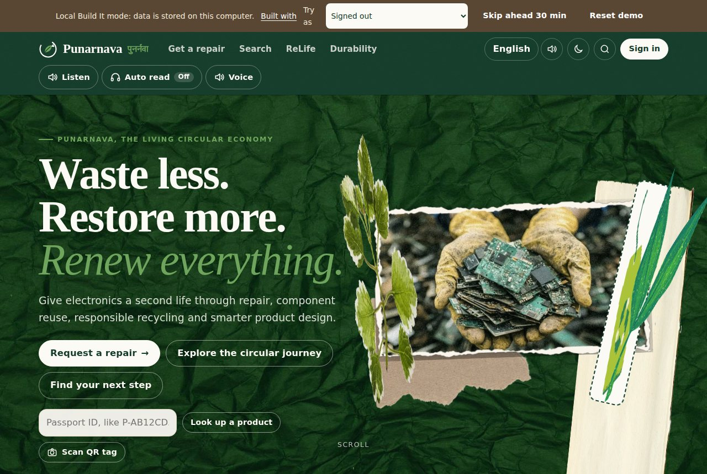

</div>

---

## The problem: India throws away what it could repair

The world generated a record **62 million tonnes of e-waste in 2022**, and only **22.3%** of it was documented as properly collected and recycled. E-waste is growing **five times faster** than documented recycling and is on track for **82 million tonnes by 2030**. The UN names *limited repair options* and *short product lifecycles* among the drivers. ([UN Global E-waste Monitor 2024](https://unitar.org/about/news-stories/press/global-e-waste-monitor-2024-electronic-waste-rising-five-times-faster-documented-e-waste-recycling))

India generated **17,51,236 tonnes** of e-waste in FY 2023-24, and **7,60,663 tonnes** were recycled: under half. ([Rajya Sabha, Unstarred Q. 1177, 1 Aug 2024](https://rsdebate.nic.in/bitstream/123456789/748973/1/PQ_265_01082024_U1177_p244_p245.pdf)) That is up from 10.14 lakh tonnes in 2019-20, a rise of about 72% in five years. ([Rajya Sabha reply, Dec 2024](https://www.communicationstoday.co.in/indias-e-waste-generation-jumps-72-over-the-last-five-years/)) The government launched the [Right to Repair Portal India](https://righttorepairindia.gov.in/) to bring repair information to consumers and reduce e-waste. Repair is now national policy.

But the real decision happens at a **neighbourhood repair counter**, and nothing there is designed for the circular economy:

| At the repair counter today | The cost |
|---|---|
| The owner gets a verbal quote, with no idea whether it is fair or whether repair is even worth it | Good products are replaced; bad repairs are paid for |
| The technician has no data on which part usually fails in this model | Slower diagnosis, guesswork, more wasted parts |
| The working parts inside a dead appliance go to scrap | A ₹1,400 motor is sold for a few rupees a kilo |
| The carcass goes to whoever pays most, often informal burning and acid baths | Toxic exposure; metals lost |
| The manufacturer never learns that *this* board fails after 30 months | The same design flaw ships again |

**Punarnava turns that one moment into a fair, recorded, verifiable decision, and connects everyone who can give the product another life.**

---

## The idea: five chances before waste

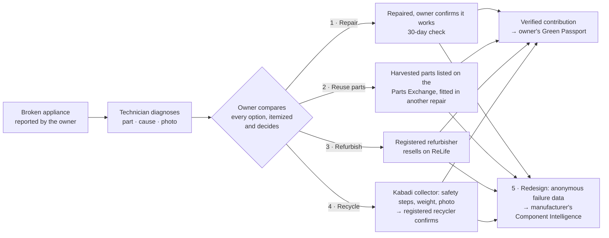

Every product carries a **public Product Passport** (QR tag, lifecycle timeline, part lineage). Every owner gets a **private Customer Green Passport** of verified contributions. Every decision feeds **Component Intelligence**, which tells manufacturers which part fails, why, and what to change.

---

## What each person gets

| | Who | What Punarnava gives them |
|---|---|---|
| 🏠 | **Appliance owner** (customer) | Report a problem by typing or voice in 5 languages. See matched technicians and *why* each was suggested. Compare repair, reuse, sale, harvest and recycling side by side with **itemized money, ownership, warranty and what happens next**. **Nothing proceeds until they choose and agree.** Track the journey and earn verified points. |
| 🔧 | **Repair technician** | Requests from nearby customers (contact revealed only after accepting), digital job cards, a fair-price check, failure data for this exact model, an assistant that suggests parts to check first, a Parts Exchange to buy and sell used parts, warranty and bill records. |
| ♻️ | **Kabadi collector** | Nearby pickups with published rates, mandatory safety steps (capacitors discharged, refrigerant recovered), weight and photo evidence, and handover to a **registered** recycler. |
| 🏭 | **Recycler and refurbisher** | Verified incoming material with chain of custody; refurbished products listed on **ReLife** with a tested checklist and warranty, and buyer leads. |
| 📊 | **Manufacturer** (brand) | Which component fails, at what age, why, and where: within-model shares only, minimum sample sizes, synthetic data labelled, spike alerts, design recommendations, a downloadable **PDF diagnostic report**, and a design assistant. No customer data, ever. |
| 🛡️ | **Admin** | Approvals of recyclers and brands, the model catalog, synthetic-data controls, spike checks. |

<table>
<tr>
<td width="50%">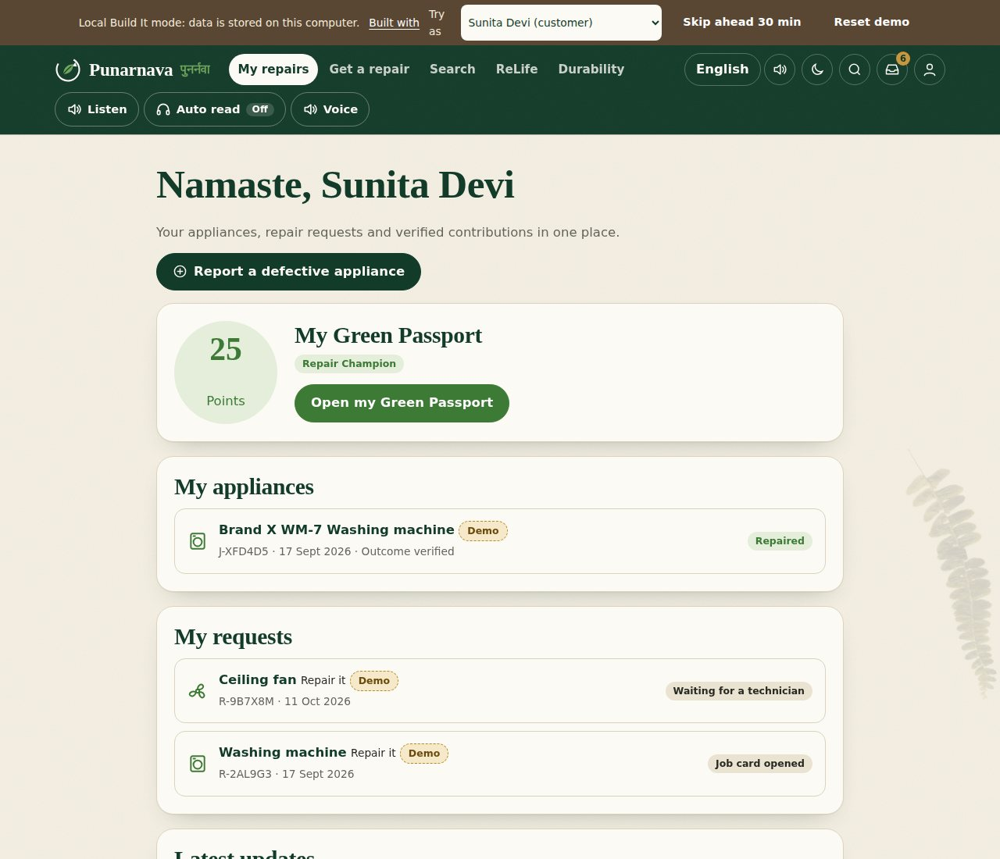<br><sub><b>My repairs</b>: the customer's appliances, requests, decisions waiting and verified points.</sub></td>
<td width="50%">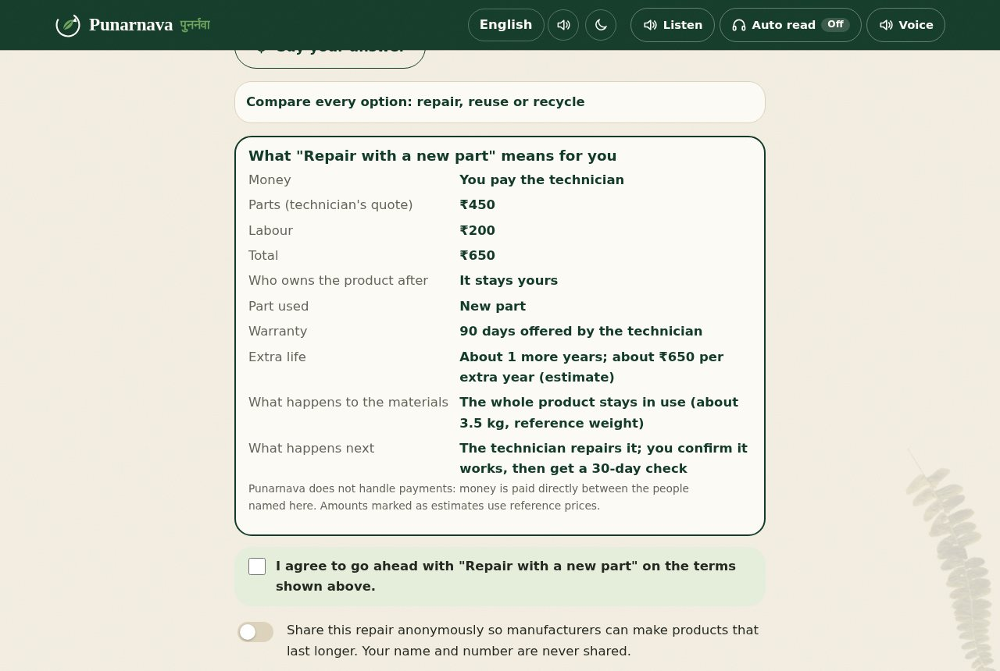<br><sub><b>Fair decision</b>: nothing preselected; who pays whom, ownership, warranty and what happens to the materials; explicit agreement required.</sub></td>
</tr>
<tr>
<td>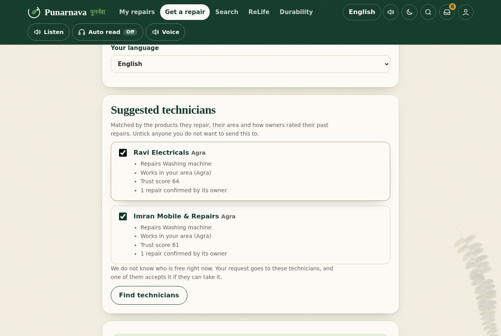<br><sub><b>Explained matching</b>: product, area and trust; no fake "available now".</sub></td>
<td>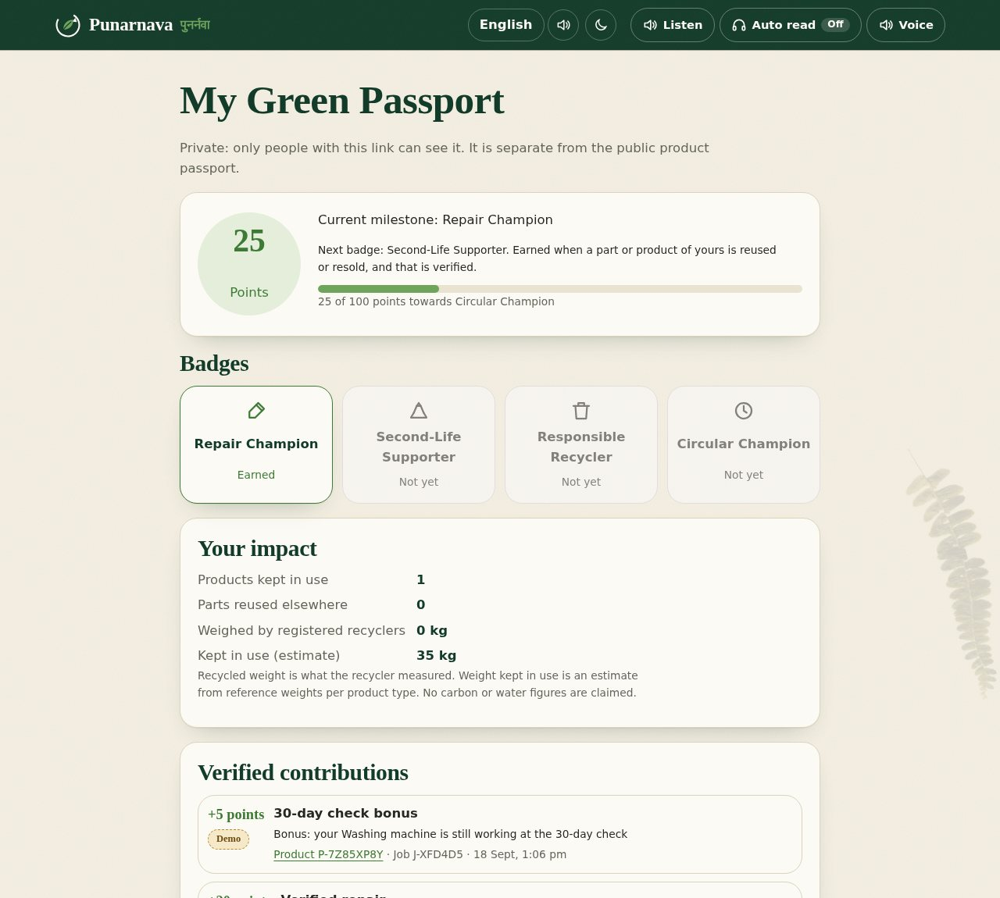<br><sub><b>Green Passport</b>: points only for verified outcomes, each linked to its job, with badges and measured vs estimated impact.</sub></td>
</tr>
<tr>
<td>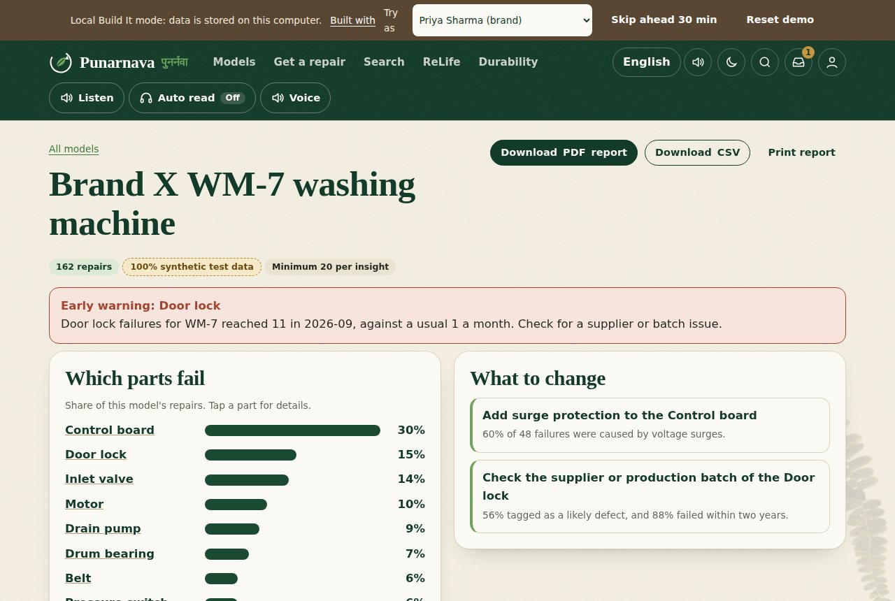<br><sub><b>Component Intelligence</b>: within-model failure shares, spike alerts, design changes, PDF report.</sub></td>
<td>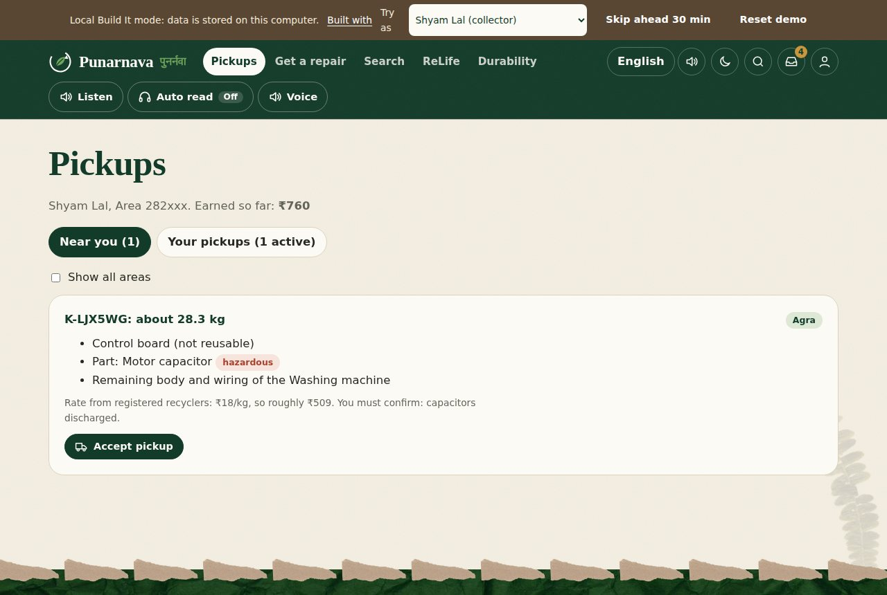<br><sub><b>Kabadi Connect</b>: safety steps, weight, photo and a registered recycler, before anything counts as recycled.</sub></td>
</tr>
</table>

---

## Trust by design: built so it cannot be gamed

A circular-economy app is only as good as its numbers. These rules are **enforced on the server and covered by tests**, not just shown in the UI.

- **The owner decides, never the technician.** For customer requests the technician never receives the owner's link. Every decision (including *decline all*) needs `agree: true`, and the agreed terms are snapshotted for audit.
- **The fair price cannot be bent.** The technician's suggestion and offered warranty are shown and labelled, and never move Punarnava's fair-price range.
- **Points only for verified outcomes, exactly once.** A repair counts when the owner confirms it works; reuse when the handover is recorded *and* the repair it went into works; recycling only when a **registered recycler confirms receipt** with weight and photo. Unique reward keys and conditional writes make retries and races award nothing extra. There is no API to submit points.
- **No fabricated impact.** The public impact counter counts real activity only: synthetic analytics and labelled demo journeys are excluded, and shown separately. Carbon and water figures are deliberately not claimed.
- **Privacy first.** The customer's phone stays hidden until a technician accepts. Search indexes no personal data. Brand reports are anonymous aggregates. Passports can be found only by exact ID.
- **Deny by default.** Every one of the 88 API routes passes a **Cedar** policy check before it runs, on top of the route's own role checks.
- **Honest AI.** The assistant always shows the rule-based answer. An AI narrative is accepted only if every number in it appears in the data, every reference is a real ID, and it makes no safety or guarantee claim; otherwise it is dropped and the page says why.

---

## Built with Build It: 11 of 11 tools, each with a real job

> **Build It:** open source, on your machine. No AWS account, no card, no bill.

| Category | Tool | Its job in Punarnava | Where |
|---|---|---|---|
| Agents and AI | **Strands Agents SDK** | A local agent (Ollama model) that calls 4 bounded Punarnava data tools to explain diagnoses, recommendations and design fixes, with structured output re-validated by the server | [`agent/`](agent/), [`backend/src/core/assist.js`](backend/src/core/assist.js) |
| | **PartyRock** | A no-code "Repair or replace?" companion app built from Punarnava's own reference data | [`partyrock/`](partyrock/) |
| Containers and Kubernetes | **Finch** | Runs LocalStack and OpenSearch, and builds every image, with one start and stop command | [`local/compose.yaml`](local/compose.yaml), [`scripts/local/start.sh`](scripts/local/start.sh) |
| | **EKS Anywhere** | Creates a local cluster that runs the whole stack from Kubernetes manifests | [`deploy/eks-anywhere/`](deploy/eks-anywhere/), [`deploy/k8s/`](deploy/k8s/) |
| | **EKS Distro** | The Kubernetes distribution those nodes run (the app reports the exact build) | [`scripts/local/k8s-up.sh`](scripts/local/k8s-up.sh) |
| Serverless | **AWS SAM CLI** | Runs the same API as a local Lambda function with `sam local start-api`, never deployed | [`sam/template.local.yaml`](sam/template.local.yaml) |
| | **LocalStack** | DynamoDB for records and S3 for photos and voice notes, seeded and reset by script | [`local/localstack/`](local/localstack/) |
| Servers and runtimes | **Firecracker** | Isolates the AI agent in its own KVM microVM, away from the app | [`firecracker/`](firecracker/) |
| | **Amazon Corretto** | The JVM OpenSearch runs on, read live from OpenSearch itself | [`local/opensearch/Containerfile`](local/opensearch/Containerfile) |
| Data and search | **OpenSearch** | Search across parts, refurbished listings and product models in five languages; records indexed when written; store fallback if it is stopped | [`backend/src/local/search-opensearch.js`](backend/src/local/search-opensearch.js) |
| Auth and policy | **Cedar** | Allow or deny for every API call by role and attributes: brand scope, only refurbishers list, only recyclers confirm, suspended accounts | [`policies/punarnava.cedar`](policies/punarnava.cedar) |

**Proof, not claims.** The in-app **Built with** page (`#/stack`) shows each tool's *live* state. A tool appears active only when the running server detects it working: Cedar loaded and self-tested, OpenSearch answering, the JVM vendor OpenSearch reports, the agent's model and whether it runs in a Firecracker microVM, the Kubernetes build the cluster reports, and whether Finch started the services.

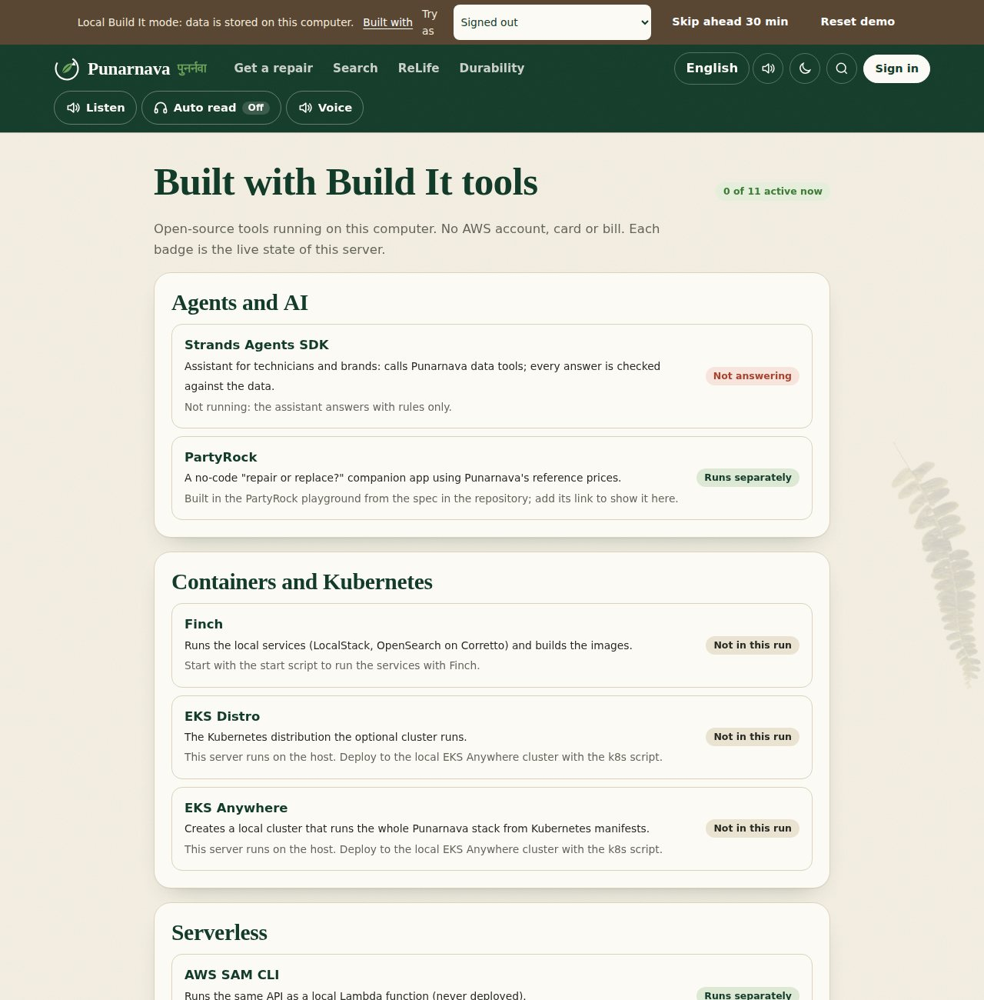

### Architecture

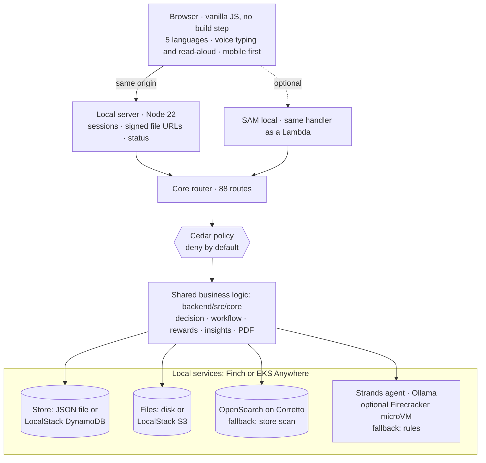

The same `backend/src/core` runs in the browser-only demo, the local server, SAM local, the tests and the optional cloud deployment. Every Build It service sits behind a port with a fallback, so **the app never breaks because an optional tool is stopped**; it says so instead. More: [docs/BUILD_IT_ARCHITECTURE.md](docs/BUILD_IT_ARCHITECTURE.md).

---

## Quick start (Linux, about 60 seconds)

```bash
git clone https://github.com/KartikaySrivastava258/Amazon-Environmental-Hacks.git
cd Amazon-Environmental-Hacks
scripts/local/start.sh --no-services     # needs only Node.js 22
```

Open **http://127.0.0.1:8787** and pick **Sunita Devi (customer)** in the **Try as** menu. The first start installs dependencies and seeds the demo: eight people, twelve connected stories and 6,000 labelled synthetic records.

<details>
<summary><b>Full Build It stack</b> (Finch, LocalStack, OpenSearch on Corretto, Cedar, Strands, SAM, EKS, Firecracker, PartyRock)</summary>

```bash
# Finch (https://runfinch.com) runs the services. Docker or Podman also work: export CONTAINER_CLI=docker
scripts/local/start.sh --full            # LocalStack DynamoDB + S3, OpenSearch on Corretto, Cedar, and the agent if Ollama is up

# The Strands agent with a local model (second terminal)
ollama pull llama3.1:8b && scripts/local/agent.sh

# The same API under SAM local, checked against LocalStack and Cedar
scripts/local/sam-smoke.sh

# The whole stack on an EKS Anywhere cluster (EKS Distro nodes)
scripts/local/k8s-up.sh                  # see deploy/README.md

# The agent inside a Firecracker microVM (Linux with KVM)
firecracker/build-rootfs.sh && KERNEL=/path/to/vmlinux firecracker/run.sh   # see firecracker/README.md

# Check everything and write a report
scripts/local/verify.sh                  # → .local-data/verify-report.txt
```

PartyRock: build the companion from [`partyrock/README.md`](partyrock/README.md), then set `PN_PARTYROCK_URL` in `.env`.
Everyday commands: `scripts/local/stop.sh` stops the services; `scripts/local/reset.sh` wipes and re-seeds.
Settings: [`.env.example`](.env.example) (every value has a safe local default).
</details>

---

## Demo accounts and seeded stories

Use the **Try as** menu at the top. Every seeded record runs through the **real workflow**, so the data is internally consistent. Every record is labelled **Demo** and kept out of real impact. Details: [docs/DEMO_DATA.md](docs/DEMO_DATA.md).

| Account | Role | What is waiting for you |
|---|---|---|
| **Sunita Devi** | customer | A verified washing-machine repair (**25 points, Repair Champion**); a new request waiting for a technician |
| **Arjun Mehta** | customer | **A decision to make** (mixer-grinder); a recycled fridge (**40 points, Responsible Recycler**); a declined repair |
| **Ravi Kumar** | technician | Sunita's request to accept, a repair in progress, harvested parts, exceptions (no decision, not working) |
| **Imran Khan** | technician | A repair with a **reused** door lock; the Parts Exchange; a saved-search alert |
| **Shyam Lal** | collector | An open pickup with safety steps |
| **GreenCycle Recyclers** | recycler and refurbisher | A delivery to confirm; a ReLife listing for sale with a buyer lead |
| **Priya Sharma** | brand (Brand X) | Component Intelligence, PDF report, design assistant, spike alert |
| **Hackathon Admin** | admin | Approvals, catalog, synthetic data, spike check |

Real accounts work too: **Sign up** as a customer (active at once) or as a technician, collector, recycler or brand (recyclers and brands wait for admin approval).

### 5-minute judge walkthrough

1. **Sunita (customer)** → *Report a defective appliance* → washing machine, a symptom → *Find technicians* (see *why*) → consent → *Send*.
2. **Ravi (technician)** → *Requests*: the phone is hidden until he accepts → *Accept* → job card → *Diagnose* (try *Ask the assistant*).
3. **Sunita** → *My repairs* shows a decision waiting → nothing preselected → *Compare every option* → choose → *Confirm* stays locked until she agrees.
4. **Ravi** completes the repair → **Sunita** taps *Yes, it works* → **+20 verified points** (25 → 45).
5. **GreenCycle** confirms the waiting delivery: only now does that recycling journey become *verified*.
6. **Priya (brand)** → WM-7 → *Download PDF report* (synthetic and demo clearly labelled).
7. **Built with** (top bar): each Build It tool's live state. **Cedar** blocking a collector from a technician action:
   `curl -X POST -H "authorization: Bearer $(node backend/src/local/cli.js token demo-shyam)" http://127.0.0.1:8787/api/jobs` → `403`
8. Switch to **हिंदी** or **தமிழ்**, tap **Listen**, and pick a clearer voice with **Voice**.

---

## For India: language, voice and low-end phones

- **Five languages** (English, हिंदी, मराठी, বাংলা, தமிழ்) across every screen, with 1,732 translation keys checked automatically for missing or untranslated strings.
- **Voice typing** into any field, and **read-aloud** of whole pages. The clearest installed voice is chosen first, voices can be chosen and tested per language, and prices are read naturally ("3,250 to 4,350 rupees").
- **Works offline-first**: browser-native speech, no paid API, no cloud credentials. Mobile layout down to 360 px, dark theme, reduced motion, and a command palette.

<p align="center">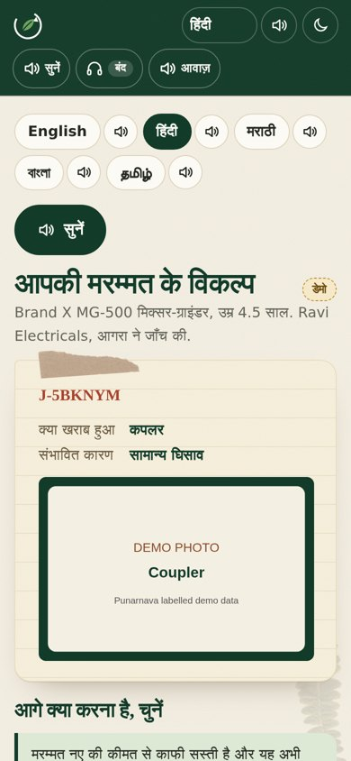</p>

---

## Tests and quality

```bash
cd backend && npm install && npm test
```

| Suite | Covers |
|---|---|
| Core (34) | Fair price, options, workflow, parts, pickups, ReLife, insights, roles, languages |
| Customers, rewards, PDF (14) | Verified rewards exactly once under retries, badges, private Green Passport, matching, consent, brand-scoped PDF without personal data |
| Customer accounts and demo seed (3) | Idempotent seed, every workflow state, demo labels, impact exclusion, customer journey including decline |
| Cedar (structure + engine) | Policy matches all 88 routes; the official Cedar engine checks **every route × 9 kinds of user**, plus attribute rules |
| Local server (13) | Sessions, accounts, signed uploads, voice-note replay, OpenSearch and agent adapters with fallbacks, retry-safe timers, restart persistence, live Build It detection |
| Voice (6 + 1) | Permissions, insecure pages, unsupported languages, cancel and stop, voice ranking and choice |
| Translations | Every key in 5 languages, matching placeholders, strict mode in CI |

Plus a Playwright walkthrough of the whole customer journey and every role, with an untranslated-text check in all five languages: `python3 scripts/e2e-customer.py`. CI runs on every push: [`.github/workflows/ci.yml`](.github/workflows/ci.yml).

---

## Repository layout

```
backend/src/core/      shared business logic (local server, SAM local, tests, browser demo)
backend/src/local/     local Build It server + adapters: files, LocalStack, OpenSearch, Cedar, agent, CLI
backend/src/handlers/  local-api.js (SAM local); api/async/auth/workflow.js (optional cloud only)
backend/test/          core, customer, demo seed, Cedar, local server and voice tests
frontend/              the web app (vanilla ES modules, no build step) and 5-language catalogs
policies/              Cedar policy, generated from the route table and checked in CI
agent/                 Strands Agents service (Python, local Ollama model)
local/                 Finch compose file, LocalStack init, OpenSearch mappings and Corretto image
sam/                   SAM template for `sam local` only
deploy/                EKS Anywhere cluster config and Kubernetes manifests
firecracker/           agent microVM: rootfs build, VM config, launcher
partyrock/             PartyRock companion app spec and generated reference data
scripts/local/         start, stop, reset, seed, agent, verify, sam-smoke, k8s-up and k8s-down
docs/                  architecture, demo data, features, i18n and specifications
cloud-optional/        an earlier AWS deployment, not used by the local run
```

---

## Honest limits

- **Brands, models, prices and weights** are fictional reference values; demo and synthetic records are labelled everywhere and never counted as real impact.
- **Build It services on your machine.** Cedar 4.13 ran on a developer laptop. OpenSearch, LocalStack, SAM, Strands with Ollama, EKS Anywhere and Firecracker are wired to their documented interfaces and tested through stand-ins; `scripts/local/verify.sh` reports what works on yours. LocalStack Community does not keep data across container restarts (the app re-seeds; default file storage is durable).
- **Voice quality** depends on the voices installed on the device. The app picks the clearest, but cannot create a natural voice that isn't there.
- **Translations** are drafts that still need native-speaker review.
- **Local accounts** are for a laptop demo; persona sign-in has no password (turn it off with `PN_PERSONAS=false`).

## Where this goes next

Pilot with repair shops in one city; link product manuals from the [Right to Repair Portal India](https://righttorepairindia.gov.in/); connect recycler confirmations to CPCB's EPR records; replace reference prices with real market data as repairs are logged.

## Sources

- UNITAR / ITU, [Global E-waste Monitor 2024](https://unitar.org/about/news-stories/press/global-e-waste-monitor-2024-electronic-waste-rising-five-times-faster-documented-e-waste-recycling)
- Rajya Sabha, [Unstarred Question 1177, answered 1 August 2024](https://rsdebate.nic.in/bitstream/123456789/748973/1/PQ_265_01082024_U1177_p244_p245.pdf) (e-waste generated and recycled, FY 2023-24)
- PTI via Communications Today, [Rajya Sabha reply, December 2024](https://www.communicationstoday.co.in/indias-e-waste-generation-jumps-72-over-the-last-five-years/) (2019-20 to 2023-24 trend)
- Department of Consumer Affairs, [Right to Repair Portal India](https://righttorepairindia.gov.in/)

---

<div align="center">

**Punarnava** (पुनर्नवा) is Sanskrit for *"that which is renewed again"*.
Built for **Amazon Environmental Hacks** on the **Build It** track: open-source tools, on your machine, no bill.<br>
By [KartikaySrivastava258](https://github.com/KartikaySrivastava258)
[MIT License](LICENSE)

</div>
